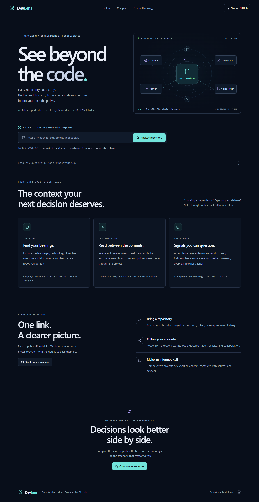
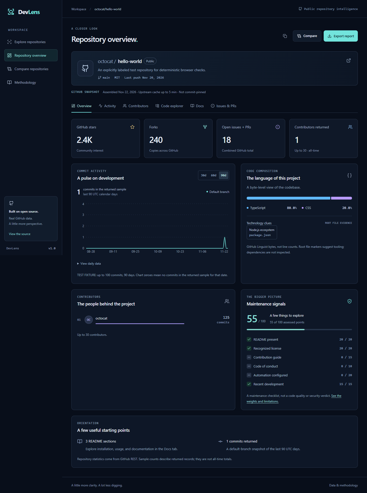
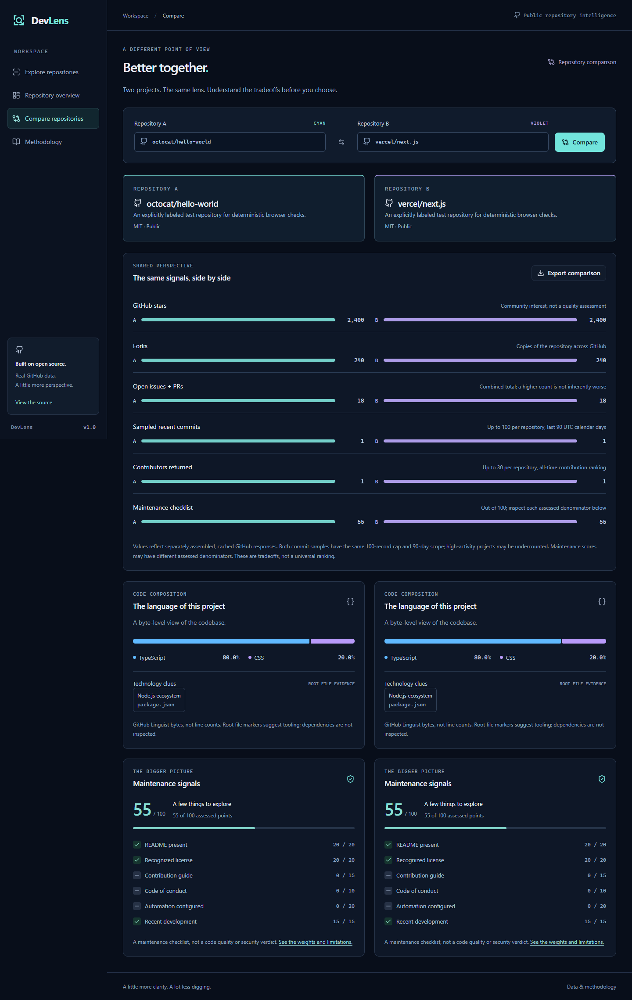

# DevLens

**See beyond the code.** A public GitHub repository intelligence workspace built with Next.js, TypeScript, and a little more perspective.



Explore a repository's code, people and momentum without bouncing between tabs. DevLens brings GitHub's public data into a responsive midnight workspace, with transparent samples, inspectable maintenance signals and portable reports.

## What it does

- Analyze public repositories from an HTTPS GitHub URL or `owner/name`.
- View repository totals, language byte composition and root-file technology clues.
- Explore recent commit activity with 30/60/90-day controls and accessible daily data.
- Search contributors, sort by name or contribution count, and hide bots.
- Expand repository folders and preview UTF-8 text files on demand.
- Read sanitized Markdown READMEs and heading-based documentation insights.
- Filter sampled issues and pull requests; inspect merged PR counts and issue closure times.
- Inspect every maintenance indicator, its weight, evidence and assessed denominator.
- Compare two repositories with the same sampling methodology and share the comparison URL.
- Download Markdown reports, JSON snapshots and combined comparison reports.
- Use desktop/mobile layouts, keyboard tabs, reduced-motion interactions, and explicit loading/error/empty states.

No fictional live values. No account required. No browser token storage. Data comes from the GitHub REST API through server-only routes.

## Run locally

Use **Node.js 24** (22+ supported).

```sh
git clone https://github.com/gupta-srishtii/DevLens.git
cd DevLens
npm ci
cp .env.example .env.local
npm run dev
```

Open [localhost:3000](http://localhost:3000). On Windows PowerShell, use `npm.cmd` if `npm.ps1` is restricted; copy the environment with `Copy-Item .env.example .env.local`.

The token is optional. Set `GITHUB_TOKEN` in `.env.local` for a higher API allowance, using a fine-grained read-only token restricted to public repositories. Keep it server-side. `NEXT_PUBLIC_SITE_URL` configures the production metadata origin; Vercel's assigned URL is used automatically when this is omitted.

Example routes: `/repo/vercel/next.js`, `/repo/facebook/react`, `/compare?left=vercel%2Fnext.js&right=vitejs%2Fvite`.

## A closer look





Dashboard and comparison screenshots use deterministic **test fixtures**, visibly labeled in the repository description. They illustrate the interface and do not claim to show live GitHub statistics. Production has no fixture mode or fallback dataset.

## Data, with context

Stars and forks are GitHub totals. Commit activity is limited to 100 latest default-branch commits over 90 UTC calendar days; contributors to 30; issue/PR analytics to recently updated samples of 100 records. Root-file markers suggest tooling, not dependency versions. Each panel and exported report describes its scope.

The maintenance checklist measures README, license, contribution guide, code of conduct, workflow presence and recent pushes. Unknown sources are excluded from the denominator. It is **not a code quality or security score**. See the in-app `/methodology` page and [architecture notes](docs/ARCHITECTURE.md).

Upstream requests are cached for up to five minutes. GitHub's own caches and rate limits still apply. A cold repository analysis uses nine upstream requests; comparison uses up to eighteen. Unauthenticated access is normally limited to 60 API requests/hour per originating IP. Missing optional data produces a partial snapshot with warnings.

## Stack

| Layer         | Technology                                                                    |
| ------------- | ----------------------------------------------------------------------------- |
| Application   | Next.js 16 App Router, React 19, strict TypeScript                            |
| Styling       | Tailwind CSS 4, CSS design tokens, local shadcn-style Radix/CVA UI primitives |
| Interaction   | Motion for React, Radix keyboard-accessible tabs                              |
| Visualization | Recharts and accessible tabular alternatives                                  |
| Data          | GitHub REST API, Zod runtime validation, server-only fetch cache              |
| Documentation | React Markdown, remark-gfm, HTML/image suppression                            |
| Quality       | Vitest, React Testing Library, Playwright, axe, ESLint, Prettier              |
| Delivery      | GitHub Actions, pinned action SHAs, Vercel configuration                      |

No database is used: read-only snapshots do not require persistence. The repository map and visual identity are original. Animated-tab patterns were referenced on [21st.dev](https://dev.21st.dev/@kuratlielia/components/tabs); no registry code is silently downloaded at runtime.

## Development and checks

```sh
npm run check          # lint, strict types, unit/integration/component tests, production build
npm run format:check   # source and documentation formatting
npm run test:coverage  # data-layer V8 coverage
npx playwright install --with-deps chromium
npm run test:e2e       # production server, desktop/mobile journeys and axe checks
```

On Windows with installed Edge, the browser tests use Edge automatically. Test fixtures are confined to `tests/`. CI performs the same checks on Linux and uploads reports. See [testing details](docs/TESTING.md) for coverage and verification limits.

## Project guide

- [Architecture and tradeoffs](docs/ARCHITECTURE.md)
- [Vercel and self-hosting deployment](docs/DEPLOYMENT.md)
- [Testing and screenshot provenance](docs/TESTING.md)
- [Implementation roadmap](docs/ROADMAP.md)
- [Verified progress and external blockers](docs/PROGRESS.md)
- [Changelog](CHANGELOG.md)
- [Security model](SECURITY.md)

## Deployment and current scope

`vercel.json` prepares a standard Next.js deployment. No production URL is claimed; connecting the owner's Vercel account/project is a remaining external step. See [deployment instructions](docs/DEPLOYMENT.md).

Private repositories, exhaustive history pagination, dependency version analysis, organization defaults, non-GitHub CI evaluation, security scanning, saved accounts and persistent reports are outside this release. Per-process rate limiting needs an edge/distributed counterpart before a high-traffic public launch. Browser verification covers Chromium desktop/mobile viewports, not all engines or real devices.

Contributions should preserve the distinction between totals, samples, unknown data and heuristics. Run the quality gates, update the relevant documentation and keep credentials out of commits.
