# Architecture

DevLens is a read-only Next.js App Router application. No database is necessary: analyses are bounded snapshots of public GitHub resources, and reports are generated from the loaded snapshot in the browser.

## Request flow

```mermaid
flowchart LR
  A[Repository input] --> B[Shared Zod validation]
  B --> C[Shareable repository route]
  C --> D[Analysis API]
  D --> E[Public repository check]
  E --> F[Server-only REST client]
  F --> G[GitHub REST API]
  G --> H[Runtime response schemas]
  H --> I[Analytics and checklist]
  I --> J[Snapshot with scope and warnings]
  J --> K[Dashboard or comparison]
  K --> L[Local Markdown and JSON exports]
```

## Module boundaries

| Location                    | Responsibility                                                                                  |
| --------------------------- | ----------------------------------------------------------------------------------------------- |
| `src/app`                   | Routes, metadata, layouts, error/loading boundaries and API handlers                            |
| `src/components/ui`         | Locally owned shadcn-style Radix/CVA primitives                                                 |
| `src/components`            | Presentation panels and interactions, grouped by capability                                     |
| `src/hooks/use-analysis.ts` | Abortable client loading, error and retry state                                                 |
| `src/lib/repository.ts`     | Repository and file-path validation, shared with the client                                     |
| `src/lib/github/schemas.ts` | Zod validation for upstream data; strips unknown fields                                         |
| `src/lib/github/client.ts`  | Fixed-origin transport, server-only credential handling, timeouts, cache policy and safe errors |
| `src/lib/github/analyze.ts` | Public-only checks, bounded orchestration and partial snapshot assembly                         |
| `src/lib/github/files.ts`   | On-demand directories and text previews                                                         |
| `src/lib/analytics.ts`      | Pure byte composition, commit grouping, medians, README and file-marker heuristics              |
| `src/lib/health.ts`         | Explainable weighted maintenance checklist                                                      |
| `src/lib/reports.ts`        | Portable snapshot exports; no additional external calls                                         |

Type-only imports keep server implementation details out of client bundles. `server-only` guards transport and API helpers. React Markdown is loaded when the Docs panel opens. There are no production fixtures, hidden demo fallbacks or test bypass routes.

## External data budget

An uncached analysis makes nine calls: repository metadata, languages, commits, contributors, issue sample, pull-request sample, root files, README and workflows. Metadata must succeed and describe a public repository. Secondary resources run in groups of at most three. Each request times out after 12 seconds; worst-case sequential orchestration can approach 48 seconds. Analysis functions are configured for 60 seconds.

Next.js fetch caching revalidates upstream responses after 300 seconds. API responses use private browser caching for 60 seconds. No personal authentication state is sent by browsers. Snapshots are assembled from separate cache entries and are not consistent at one commit SHA. On-demand folder/file reads may be newer than the overview. A token change invalidates fetch keys because request headers participate in caching.

Data volumes stay bounded: 100 commits, 30 contributors, 100 issue/PR records, 100 PRs, and GitHub's 1,000-entry directory cap. We intentionally do not crawl an entire repository or exhaustively paginate its history. This keeps latency and API usage predictable. The UI and reports state these limits.

## Failure semantics

- Metadata failure fails the analysis with a structured, safe error.
- Confirmed missing resources and empty repositories do not generate a warning for every absent section.
- Other optional failures preserve successful sections and add visible warnings.
- Health signals with failed sources are unknown; their weights leave the assessed denominator.
- Null means unavailable or absent; an empty list means a successful empty response. The UI avoids converting null to a metric of zero.
- Rate-limit responses carry a retry timestamp and `Retry-After`. No automatic retry loop hammers GitHub.
- Repository redirects ask the user for the current canonical name; credentials are never forwarded through redirects.

## Client interactions

Routes carry normalized repository identities. Comparison query parameters reproduce both inputs. Tabs use Radix keyboard semantics and Motion indicators. File expansion fetches directories only when requested, aborts on unmount, and guards against stale file-preview responses. List filters operate only on loaded samples. JSON and Markdown exports download locally, with no analytics database or upload.

## Design system

The interface uses midnight backgrounds (`#080e1a`), layered navy surfaces, cyan (`#72e4dc`) emphasis, and restrained violet accents. CSS is split between shared/landing styles and workbench panel styles. Tailwind utilities supplement component classes. System fonts avoid build-time network dependencies. The brand and repository map are original SVG/CSS compositions.

The tab indicator takes conceptual inspiration from [21st.dev animated tabs](https://dev.21st.dev/@kuratlielia/components/tabs); implementation is locally owned and uses Radix for semantics. UI primitives follow [shadcn's manual installation model](https://ui.shadcn.com/docs/installation/manual). No unreviewed registry scripts run during setup.

Motion respects the user preference through MotionConfig, explicit reduced-motion hooks, and CSS. Content remains visible before reveal transitions. Recharts includes a daily data table; charts never provide the only way to read the values.

## Tradeoffs and extensions

- The per-process request guard is best effort, not a distributed quota. Add Vercel Firewall rules or a shared rate limiter for a widely exposed deployment.
- No persistent accounts, saved reports, private repositories, organization-wide indexing, dependency version detection, security scanning, or AI code summaries.
- Root-only policy checks miss organization defaults and nested documents. Workflow presence does not establish successful CI.
- For exhaustive historical analytics, introduce asynchronous jobs, pagination, durable snapshots and explicit freshness semantics before adding a database.

Primary references: [Next.js installation](https://nextjs.org/docs/app/getting-started/installation), [GitHub contents API](https://docs.github.com/en/rest/repos/contents), [GitHub rate limits](https://docs.github.com/en/rest/using-the-rest-api/rate-limits-for-the-rest-api).
